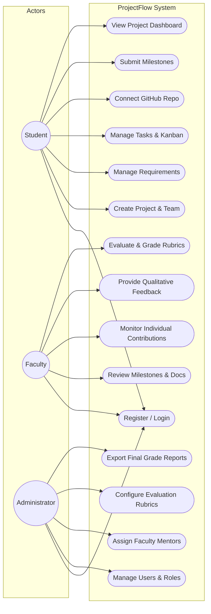
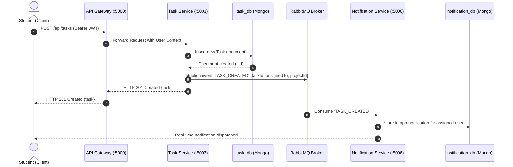
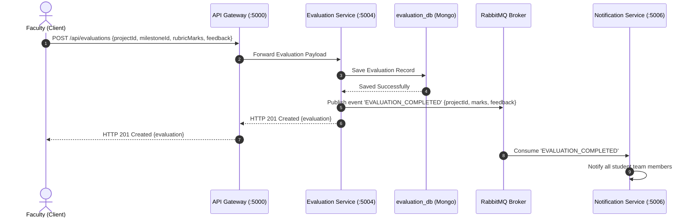

# UML Diagrams & Modeling Artifacts

This directory contains the UML design models and structural/behavioral diagrams for **ProjectFlow**.

---

## 1. Use Case Diagram

---

## 2. Sequence Diagram: Task Creation & Notification

---

## 3. Sequence Diagram: Milestone Evaluation Flow

---

## 4. Academic Reference Files
For full lab documentation and draw.io source files, refer to:
- `../SE_Projectflow.drawio`
- `../Sequence Diagram.pdf`
- `../UML.pdf`
